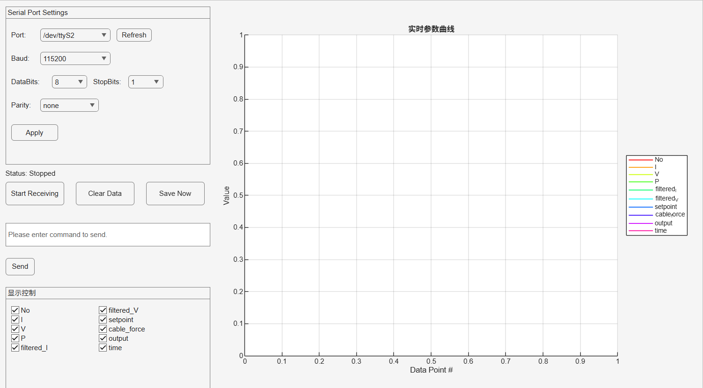

# UART communication with MATLAB

A simple MATLAB GUI for **serial data acquisition, visualization, and saving** in realtime.  

It has been tested by **matlab R2022 and R2023**.


##  Requirements

- MATLAB, has been tested by **matlab R2022 and R2023** 
- A board that is going to send serial data for testings


##  serialGUI.m


**features**



- Data Acquisition  

  - Supports line-based serial input (comma-separated with MAX 20 floats) end with `\r\n`. 

    Example data:  

    ```
    packageID, float1, float2, float3, float4, float5, float6, float7, float8, microTimeStamp
    6556,460,0,8,419.07,-0.14,15,15.05,-0.24,72226678
    ```

- Real-Time Plotting 

  - Checkboxes to toggle visibility of each data curve  
  - Autoscaling of axes  

- Data Management  

  - Save current dataset as `.mat` file (with timestamp in filename) , so you will never overwrite data inadvertently.
  - Automatic save when stopping or closing. But you can also *skip* by not putting in filename to keep you workspace clean.

**Usage**

1. Clone or download this repository.  
2. Open `serialGUI.m` in MATLAB and run in MATLAB Command Window:
3. Select the serial port and parameters. Click button to start.
6. Saved data will appear as `YYYYMMDD_HHMMSS_serial_data.mat` in the working directory.


## UART_reading.m

 **Features**

- Connects to a specified COM port with configurable baud rate.
- Reads and parses sensor data lines in the format: `'a value1 value2 value3 value4'`.
- Plots sensor data in real-time with a fixed number of displayed points.
- Automatically timestamps and saves collected data as a `.mat` file.
- Data will be saved automatically at the end or in case of errors.

 **Usage**

1. Update the `port` and `baudRate` variables to match your device.
2. Set a descriptive note in `note_tosave`.
3. Run the script in MATLAB to start collecting and plotting sensor data.
